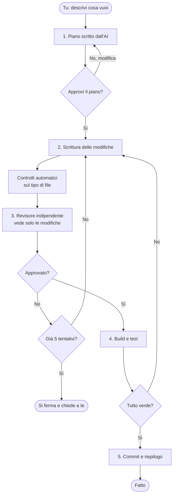
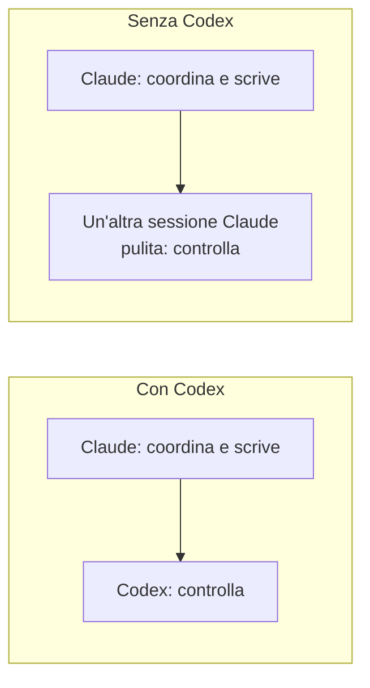

# OMEGA-LOOP

**Un processo di lavoro in cui un'AI scrive il codice e un'altra lo controlla, prima che tu lo veda.**

OMEGA-LOOP funziona dentro [Claude Code](https://claude.com/claude-code). Si installa una volta sola e poi lavora per te su qualsiasi progetto. Se hai anche [Codex](https://github.com/openai/codex) di OpenAI lo usa; se non ce l'hai funziona lo stesso.

---

## Perché esiste

Quando chiedi a un'AI di modificare del codice, di solito succede questo:

* l'AI scrive il codice;
* l'AI ti dice "fatto, funziona";
* tu ti fidi, e scopri i problemi dopo.

È come far correggere il compito allo studente che l'ha scritto: tende a dirsi bravo. OMEGA-LOOP mette una regola semplice: **chi scrive non può mai giudicare il proprio lavoro**. Il controllo lo fa sempre un altro revisore, che vede solo le modifiche e non la conversazione che le ha prodotte, e il cui compito è trovare difetti.

## Cosa fa, in parole semplici

1. **Fa un piano** e te lo mostra. Non tocca nulla finché non lo approvi.
2. **Scrive le modifiche**, piccole e mirate.
3. **Le fa controllare** da un revisore indipendente. Se trova problemi, l'AI corregge e si riprova (massimo 5 giri, poi si ferma e chiede a te).
4. **Verifica** che il progetto compili e che i test passino.
5. **Salva le modifiche** (commit) solo se è tutto a posto, seguendo le regole del tuo progetto.

Mentre lavora scrive un diario in una cartella `.omega/` dentro il progetto, così, se qualcosa si interrompe, si può riprendere da dove si era rimasti.

### Schema



### Chi fa cosa (e cosa succede se uno finisce i token)



* **Codex presente:** Claude coordina e scrive, Codex fa il revisore.
* **Codex assente:** il revisore è una seconda sessione di Claude, nuova e senza memoria di ciò che è stato scritto.
* **Codex finisce i token (o dà errore):** il suo lavoro passa subito a Claude, senza fermarsi.
* **Claude finisce i token:** il controllo passa a Codex e puoi far riprendere il lavoro a Codex con un solo comando (vedi sotto).
* **Installi Codex in futuro:** viene riconosciuto da solo, a ogni nuova chat. Non devi configurare niente.

## Cosa ti serve

* **Claude Code** installato e funzionante (anche l'estensione per VS Code va bene).
* **macOS o Linux.** Su Windows usa WSL.
* **Python 3** (di solito c'è già).
* Facoltativo: **Codex** per avere un revisore di un'altra azienda.

## Installazione

Apri il terminale e incolla:

```bash
git clone https://github.com/priore/omega-loop.git
cd omega-loop
./install.sh
```

Fatto. L'installazione:

* copia i file in `~/.claude/` (la cartella di Claude Code, solo tua);
* aggiunge un piccolo avvio automatico in modo che OMEGA-LOOP sia pronto in ogni nuova chat;
* dice a git di ignorare la cartella `.omega/` in tutti i tuoi progetti, così il diario di lavoro non finisce mai nei tuoi commit.

È sicura da rilanciare per aggiornare. Prima di toccare le impostazioni di Claude Code ne salva una copia (`settings.json.omega.bak`).

## Come si usa

**Apri una nuova chat** di Claude Code nel tuo progetto (le chat già aperte non vedono l'installazione) e scrivi:

```text
/omega-loop aggiungi un pulsante "Esporta in PDF" alla pagina dei report
```

Cambia solo la frase dopo `/omega-loop` con quello che vuoi ottenere. Esempi:

```text
/omega-loop correggi il calcolo dell'IVA quando lo sconto supera il 20%
/omega-loop sposta la logica di login in un file separato, senza cambiare il comportamento
/omega-loop aggiungi la validazione dell'email al modulo di registrazione
```

Poi:

1. L'AI ti mostra il **piano**. Leggilo; se va bene rispondi di sì, altrimenti dille cosa cambiare.
2. Aspetta: scrive, fa controllare, verifica.
3. Ti dice cosa ha fatto. Il riepilogo completo è in `.omega/SUMMARY.md`.

### Parte da solo?

Sì, in parte. Ogni nuova chat riceve l'istruzione di usare OMEGA-LOOP per le modifiche **non banali** a un progetto. Domande, spiegazioni del codice e correzioni da una riga restano veloci e non passano dal piano. Se vuoi essere sicuro, scrivi `/omega-loop` esplicitamente.

### Se Claude finisce i token a metà lavoro

Dal terminale, nella cartella del progetto:

```bash
~/.claude/omega/codex_takeover.sh
```

Codex legge il diario in `.omega/` e continua dal punto in cui eravate. Non fa commit senza la tua conferma.

## Controlli automatici sul codice

Prima del revisore, alcuni piccoli controlli verificano regole semplici sul tipo di file:

| File | Cosa controlla |
| --- | --- |
| `.swift` | niente `DispatchQueue.main` né `ObservableObject` (stile Swift moderno) |
| `.scad` | struttura corretta di `difference()`, niente `minkowski()` |
| `.cs` | niente `Task.Run` per operazioni di I/O (serve `dotnet-script`) |
| `.js`, `.html` | regole AngularJS: solo nei progetti dove lo attivi |

I file di altri tipi vengono semplicemente saltati. Il controllo AngularJS è spento di default, per non dare falsi allarmi su altri progetti JavaScript. Per accenderlo su un progetto, copia `omega/projects.example.json` in `~/.claude/omega/projects.json` e metti il percorso del tuo progetto:

```json
{ "~/lavoro/mio-progetto-angularjs": { "ng": true } }
```

Questo file resta sul tuo computer, fuori dal progetto.

## Sicurezza e privacy

* Tutto ciò che OMEGA-LOOP scrive nei tuoi progetti sta in `.omega/`, ignorata da git.
* Nulla viene inviato a servizi che non usi già: il revisore è Claude o Codex, cioè gli stessi strumenti che hai installato.
* Il revisore ha accesso in sola lettura (nessun tool per Claude, sandbox in sola lettura per Codex).
* Se nessun revisore risponde, l'esito è **rifiutato**, mai approvato per errore.
* Non mettere password o chiavi nel piano o nelle richieste: finiscono nel diario `.omega/`.

## Disinstallare

```bash
./uninstall.sh
```

Rimuove i file in `~/.claude/` e l'avvio automatico. Le cartelle `.omega/` nei tuoi progetti restano (puoi cancellarle a mano).

## Domande frequenti

**Devo pagare qualcosa in più?** No, ma ogni giro di controllo usa token (di Claude o Codex), quindi un'attività consuma più di una richiesta normale. Il vantaggio è meno errori che scopri dopo.

**Funziona senza Codex?** Sì, è il caso più comune. Il revisore è una sessione Claude separata.

**Posso usarlo con un progetto senza git?** Serve un repository git: il controllo lavora sulle differenze tra prima e dopo.

**Il revisore è davvero indipendente?** Con Codex è un altro modello; senza Codex è una sessione Claude nuova che non ha visto la conversazione, solo le modifiche e il piano.

**Dove sono i dettagli tecnici?** In [docs/SPEC.md](docs/SPEC.md) (in inglese): stati, file, formato del verdetto, failover.

## Contribuire

Segnalazioni e proposte sono benvenute tramite issue e pull request. Tieni gli esempi neutri: niente percorsi assoluti personali, nomi, email o chiavi.

## Licenza

[MIT](LICENSE)
