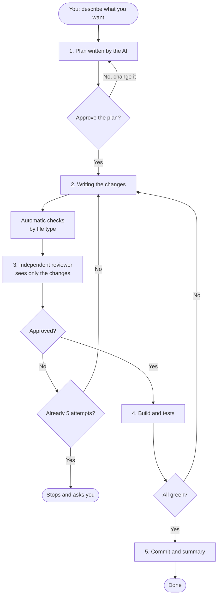
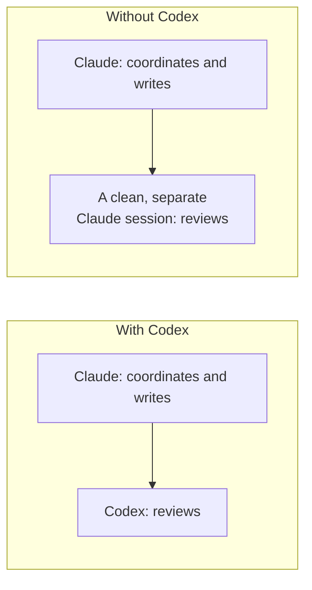

# OMEGA-LOOP

Version 1.0.0 · [MIT](LICENSE)

**A workflow where one AI writes the code and another one checks it, before you ever see it.**

OMEGA-LOOP runs inside [Claude Code](https://claude.com/claude-code). You install it once and it then works for you on any project. If you also have OpenAI's [Codex](https://github.com/openai/codex) it uses it; if you don't, it works anyway.

---

## Why it exists

When you ask an AI to change some code, this is usually what happens:

* the AI writes the code;
* the AI tells you "done, it works";
* you trust it, and find the problems later.

It's like letting the student grade their own homework: they tend to say they did great. OMEGA-LOOP adds one simple rule: **whoever writes can never judge their own work**. The check is always done by a different reviewer, who sees only the changes and not the conversation that produced them, and whose job is to find flaws.

## What it does, in plain words

1. **Makes a plan** and shows it to you. It touches nothing until you approve.
2. **Writes the changes**, small and targeted.
3. **Has them checked** by an independent reviewer. If problems are found, the AI fixes them and tries again (at most 5 rounds, then it stops and asks you).
4. **Verifies** that the project builds and the tests pass.
5. **Saves the changes** (commit) only if everything is fine, following your project's rules.

While working it keeps a log in a `.omega/` folder inside the project, so if something is interrupted it can resume from where it stopped.

### Diagram



### Who does what (and what happens if one runs out of tokens)



* **Codex present:** Claude coordinates and writes, Codex is the reviewer.
* **Codex absent:** the reviewer is a second Claude session, fresh and with no memory of what was written.
* **Codex runs out of tokens (or errors):** its work passes to Claude immediately, without stopping.
* **Claude runs out of tokens:** the review passes to Codex, and you can have Codex resume the work with a single command (see below).
* **You install Codex later:** it is detected automatically, in every new chat. Nothing to configure.

## What you need

* **Claude Code** installed and working (the VS Code extension is fine too).
* **macOS or Linux.** On Windows use WSL.
* **Python 3** (usually already there).
* Optional: **Codex**, to have a reviewer from a different company.

## Installation

Open the terminal and paste:

```bash
git clone https://github.com/priore/omega-loop.git
cd omega-loop
./install.sh
```

Done. The installer:

* copies the files into `~/.claude/` (Claude Code's folder, yours alone);
* adds a small automatic startup hook so OMEGA-LOOP is ready in every new chat;
* tells git to ignore the `.omega/` folder in all your projects, so the work log never ends up in your commits.

It is safe to re-run to update. Before touching Claude Code's settings it saves a copy (`settings.json.omega.bak`).

## How to use it

### It starts on its own

Mostly. Every new chat is told to use OMEGA-LOOP for **non-trivial** changes to a project. Questions, code explanations and one-line fixes stay fast and skip the plan. After installing, just **open a new Claude Code chat** in your project (chats that were already open don't see the installation) and describe what you want.

### Starting it manually: `/omega-loop`

To be sure the loop runs, type `/omega-loop` explicitly followed by what you want:

```text
/omega-loop add an "Export to PDF" button to the reports page
```

Only change the sentence after `/omega-loop`. More examples:

```text
/omega-loop fix the VAT calculation when the discount exceeds 20%
/omega-loop move the login logic into a separate file without changing behavior
/omega-loop add email validation to the sign-up form
```

Then:

1. The AI shows you the **plan**. Read it; if it's fine reply yes, otherwise tell it what to change.
2. Wait: it writes, gets reviewed, verifies.
3. It tells you what it did. The full summary is in `.omega/SUMMARY.md`.

### If Claude runs out of tokens mid-task

From the terminal, in the project folder:

```bash
~/.claude/omega/codex_takeover.sh
```

Codex reads the log in `.omega/` and continues from where you left off. It does not commit without your confirmation.

## Automatic code checks (what it is tuned for)

Before the reviewer runs, small checks verify simple rules based on file type. OMEGA-LOOP is currently **tuned for the following languages**; any other file type is simply skipped (the independent review still applies to everything).

* **Swift** (`.swift`): enforces modern Swift style.
  * Error: `DispatchQueue.main` is forbidden; use `@MainActor` and native async/await.
  * Error: `ObservableObject` is forbidden; use the `@Observable` macro.
  * Warning: closures that use `self.` without `[weak self]` (possible retain cycle).
  * Trade-off: the rules are strict and may flag legitimate code in projects that still use `ObservableObject`.
* **OpenSCAD** (`.scad`): enforces robust, fast 3D models.
  * Error: `difference()` must be followed by a block (`difference() { main(); subtractions(); }`).
  * Error: subtractions need height padding (e.g. `h + 0.2`) to prevent ghosting.
  * Error: `minkowski()` is forbidden because of performance; use chamfered/filleted primitives.
* **C#** (`.cs`, `.csx`): enforces async best practices. Requires `dotnet-script`; if it is missing the check is skipped with a notice.
  * Error: `Task.Run` around I/O-bound work (streams, `HttpClient`); use native async APIs.
  * Tip: consider `ReadOnlySpan<char>` instead of `string.Substring` to avoid allocations.
* **AngularJS** (`.js`, `.html`): opt-in per project (see below).
  * Error: `$scope` usage; use components with `controllerAs: '$ctrl'`.
  * Error: `ng-repeat` without `track by`.
  * Error: `$on(` listeners without cleanup in `$onDestroy`.

The AngularJS check is off by default, to avoid false alarms on other JavaScript projects. To turn it on for a project, copy `omega/projects.example.json` to `~/.claude/omega/projects.json` and put your project's path in it:

```json
{ "~/work/my-angularjs-project": { "ng": true } }
```

This file stays on your computer, outside the project. You can also enable it for a single run with `OMEGA_NG=1`.

## Security and privacy

* Everything OMEGA-LOOP writes in your projects lives in `.omega/`, ignored by git.
* Nothing is sent to services you don't already use: the reviewer is Claude or Codex, the same tools you installed.
* The reviewer has read-only access (no tools for Claude, read-only sandbox for Codex).
* If no reviewer responds, the outcome is **rejected**, never approved by mistake.
* Don't put passwords or keys in the plan or in requests: they end up in the `.omega/` log.

## Uninstall

```bash
./uninstall.sh
```

Removes the files in `~/.claude/` and the startup hook. The `.omega/` folders in your projects stay (you can delete them by hand).

## FAQ

**Does it cost extra?** No, but every review round uses tokens (Claude's or Codex's), so one task consumes more than a normal request. The benefit is fewer errors found later.

**Does it work without Codex?** Yes, it is the most common case. The reviewer is a separate Claude session.

**Can I use it on a project without git?** A git repository is required: the check works on the differences between before and after.

**Is the reviewer really independent?** With Codex it is a different model; without Codex it is a fresh Claude session that has not seen the conversation, only the changes and the plan.

**Where are the technical details?** In [docs/SPEC.md](docs/SPEC.md): states, files, verdict format, failover.

## Contributing

Issues and pull requests are welcome. Keep examples neutral: no personal absolute paths, names, emails or keys.

## License

[MIT](LICENSE)
